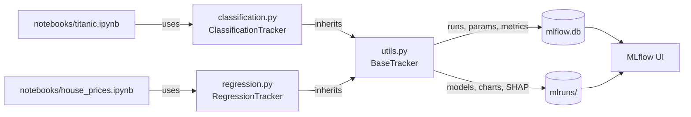
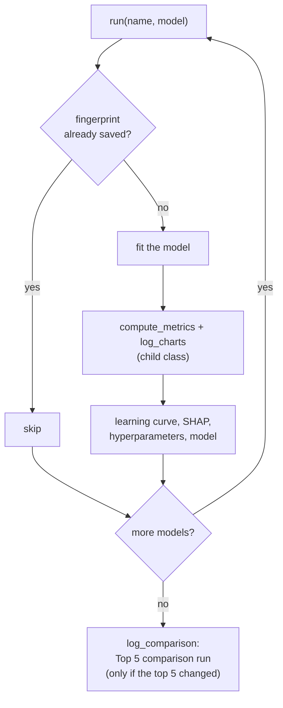

# MLflow Tracker

#### Video Demo: https://youtu.be/Bcjx2OwfBaI

#### Description:

**MLflow Tracker** trains scikit-learn models and saves *everything* about each one to
[MLflow](https://mlflow.org): the trained model, all its hyperparameters, what it learned (learned parameters), its metrics, charts
(seaborn/matplotlib), a learning curve and SHAP explanations. It never saves the same model twice,
it compares the top 5 models automatically, and the whole project can be copied to another
computer without breaking MLflow.

It has two trackers built on the same base: one for **classification** and one for
**regression**. Two notebooks show them working on classic datasets:

- **Titanic** (classification): who survived the sinking?
- **California house prices** (regression): how much is a house worth?

---

## Architecture

```
mlflow-tracker/
├── utils.py                 # BaseTracker: everything the two trackers share
├── classification.py        # ClassificationTracker(BaseTracker): metrics + charts only
├── regression.py            # RegressionTracker(BaseTracker): metrics + charts only
├── notebooks/
│   ├── titanic.ipynb        # uses classification.py
│   └── house_prices.ipynb   # uses regression.py
├── data/
│   ├── titanic.csv
│   └── house_prices.csv
└── tests/test_trackers.py
```



`BaseTracker` (in `utils.py`) does all the MLflow work. Each child class only says **how a model is
graded**:

|                | `ClassificationTracker`                                             | `RegressionTracker`                                                                       |
| -------------- | --------------------------------------------------------------------- | ------------------------------------------------------------------------------------------- |
| Metrics        | accuracy, precision, recall, F1, ROC AUC                              | MAE, RMSE, R²                                                                              |
| Charts         | confusion matrix, ROC curve, wrong predictions table                  | predicted vs. actual, residuals, residuals vs. predicted, actual vs. predicted distribution |
| Best model     | highest F1                                                            | lowest RMSE                                                                                 |
| SHAP explains  | the probability of class 1                                            | the predicted value                                                                         |
| Learning curve | the 5 metrics on train and test, with 20%...100% of the training rows | MAE, RMSE and R² on train and test, with 20%...100% of the training rows                   |

What `run_all(models)` does:



1. Computes a **fingerprint** (hash of the name, hyperparameters and data). If a run with that
   fingerprint exists, the model is skipped.
2. Trains the model, then the child class grades it: `compute_metrics()` and `log_charts()`.
3. Saves the train and test datasets, the model, every hyperparameter and learned parameter
   (also as JSON in `params/`), the learning curve and two
   SHAP charts in one MLflow run named `<project>_<model>_<date>_<time>`, for example
   `titanic_lightgbm_20261019_201530`.
4. After all models, saves a **Top 5 comparison** run with 7 charts: metrics bars, metrics heatmap,
   ranking, learning curves of the 5 models together, training time, and SHAP importance per model
   (as a heatmap and as one bar chart with every feature).

---

## Quick start

Requires **Python 3.12**.

```bash
git clone https://github.com/MarcoBispo97/mlflow-tracker.git
cd mlflow-tracker

python -m venv .venv
source .venv/bin/activate          # Windows PowerShell: .\.venv\Scripts\Activate.ps1
pip install -r requirements.txt
```

The trained models are committed (`mlflow.db` and `mlruns/`), so you can open the MLflow UI right
away (see below). To train again, open `notebooks/titanic.ipynb` or `notebooks/house_prices.ipynb`
(in VS Code or Jupyter) and run all cells. Each notebook has the same steps: data, models, train and track, compare, use the best
model, and a **production** example that loads the model from MLflow by its id
(`mlflow.pyfunc.load_model("models:/<id>")`) and scores 5 rows from the data feed.

Results on the test set:

| Notebook     | Best model | Score                               |
| ------------ | ---------- | ----------------------------------- |
| Titanic      | LightGBM   | F1 = 0.745, ROC AUC = 0.840         |
| House prices | LightGBM   | RMSE = 0.450 ($45,000), R² = 0.846 |

Run a notebook a second time and nothing is trained again: every model prints
`nothing changed -> skipped`. Change a hyperparameter and only that model gets a new run.

Then open the MLflow UI **from the project folder**:

```bash
mlflow ui --backend-store-uri sqlite:///mlflow.db
# open http://127.0.0.1:5000
```

---

## Using it with your own data

```python
import mlflow
from sklearn.model_selection import train_test_split
from regression import RegressionTracker   # or: from classification import ClassificationTracker

X_train, X_test, y_train, y_test = train_test_split(df[["a", "b", "c"]], df["price"], test_size=0.2)

mlflow.set_tracking_uri("sqlite:///mlflow.db")
tracker = RegressionTracker(
    "my_experiment", X_train, X_test, y_train, y_test, data_source="data/my_data.csv"
)
tracker.run_all({"Random Forest": RandomForestRegressor(), "Linear": LinearRegression()})

tracker.top_models()          # ranking, best first
tracker.comparison_charts()   # the 7 charts that compare the top 5
model, best_run = tracker.load_best_model()
```

The features must be numeric. For classification the target must be 0/1 and the model needs
`predict_proba` (for an SVM, use `SVC(probability=True)`).

A new kind of problem (e.g. multiclass) only needs a new child class with `METRICS`, `BEST`,
`compute_metrics()`, `log_charts()` and `predict_for_shap()`.

---

## Files

| File                                            | What it does                                                                                                                                                                                                                                                                                  |
| ----------------------------------------------- | --------------------------------------------------------------------------------------------------------------------------------------------------------------------------------------------------------------------------------------------------------------------------------------------- |
| `utils.py`                                    | `BaseTracker`: fingerprint, training, saving the model and its hyperparameters, learning curve, SHAP, ranking (`top_models`), the top 5 comparison (`comparison_charts`, `log_comparison`) and `load_best_model`. Also `make_paths_relative()`, which keeps the project portable. |
| `classification.py`                           | `ClassificationTracker`: classification metrics, confusion matrix and ROC curve.                                                                                                                                                                                                            |
| `regression.py`                               | `RegressionTracker`: regression metrics, predicted vs. actual and residuals charts.                                                                                                                                                                                                         |
| `notebooks/titanic.ipynb`                     | Titanic: 7 classifiers (polynomial logistic regression, SVM, decision tree, LightGBM, XGBoost, random forest, k-nearest neighbors).                                                                                                                                                           |
| `notebooks/house_prices.ipynb`                | California house prices: 7 regressors (linear regression, decision tree, random forest, LightGBM, XGBoost, gradient boosting, k-nearest neighbors).                                                                                                                                           |
| `mlflow.db`, `mlruns/`                      | The MLflow database and artifacts of every trained model, committed so the results can be browsed without training.                                                                                                                                                                           |
| `data/`                                       | The two datasets, kept in the repository so the notebooks work offline.                                                                                                                                                                                                                       |
| `tests/test_trackers.py`                      | pytest tests for both trackers: metrics and charts, the fingerprint, skipping repeated models, the ranking direction, loading the best model and the relative paths.                                                                                                                          |
| `requirements.txt` / `requirements-dev.txt` | The dependencies and the development tools, with pinned versions.                                                                                                                                                                                                                             |
| `.github/workflows/ci.yml`                    | GitHub Actions: black and ruff, pytest, then runs both notebooks and checks that all 14 committed models are found and skipped (this also checks the relative paths on Linux).                                                                                                                |

---

## Design decisions

**A base class and two small children.** Classification and regression trackers do the same MLflow
work and differ only in how a model is graded. The shared code lives once in `BaseTracker`, and
each child class fills in three methods (`compute_metrics`, `log_charts` and `predict_for_shap`) and three settings
(`METRICS`, `BEST`, `LOWER_IS_BETTER`). Reading one tracker explains the other.

**Datasets in MLflow.** Each run logs its training and test data with `mlflow.log_input`, so they
appear in the *Datasets* field of the MLflow UI with their schema, a profile and a hash (digest).
MLflow stores this description, not the rows: the rows stay in `data/`, and `data_source` is saved
as a relative path (`data/titanic.csv`), so it is valid on any machine.

**Hyperparameters and learned parameters.** Each run saves every hyperparameter (what you set,
including the defaults, e.g. `max_depth`) and every learned parameter (what `fit` found in the
data, e.g. `coef_`, `intercept_`, `feature_importances_`, a scaler's `mean_`). scikit-learn names
learned parameters with a trailing underscore, so one function collects them for any model. Both
go to *Parameters* (learned ones as `learned__<name>`) and to `params/hyperparameters.json` and
`params/learned_parameters.json`.

**One SHAP chart, not one per feature.** The SHAP importance of all features is saved in one CSV
per run, not as one metric per feature (MLflow would draw a separate chart for each). The comparison
run puts every feature of the top 5 models in a single chart.

**Studying the mistakes.** For classification, each run saves the test rows the model predicted
wrong as a pandas-style HTML table (`errors/wrong_predictions.html`, plus a CSV), as a
`<project>_wrong_predictions` dataset and as the `n_wrong` metric. Opening it in the MLflow UI shows
which passengers fool the model.

**Readable run names.** Every run is named `<project>_<model>_<date>_<time>` in lowercase with
underscores, so the runs sort by time and can be traced back to the moment they were trained. The
plain model name is kept in a `model` tag, which the ranking uses.

**Never save the same model twice.** Running a notebook many times usually fills MLflow with
identical runs. Before training, the tracker computes a *fingerprint*: a SHA-256 hash of the model
name, its hyperparameters and the content of the train and test data. If a run with that
fingerprint already exists, the model is skipped. I hash the data content, not just its shape,
because a different row in the training set must produce a different model.

**Learning curves for any model.** Random forests, KNN or SVMs do not train in epochs, so they
have no loss-per-epoch curve. Instead, the tracker trains copies of the model on 20%, 40%, ... 100%
of the training rows and measures every metric on those rows (train) and on the test set. This
works for every model and shows overfitting: a big gap between the train and test lines. The
points are also saved as MLflow metrics with a `step`, so the MLflow UI can draw them too.

**Ranking in the right direction.** A higher F1 is better, but a lower RMSE is better. Each tracker
lists its error metrics in `LOWER_IS_BETTER`, so `top_models()` sorts ascending for them.

**Simple charts.** The charts are PNG images made with seaborn and matplotlib (plus sklearn's
`RocCurveDisplay` and SHAP's beeswarm plot), saved with `mlflow.log_figure`.

**Model-agnostic SHAP.** Each model type needs a different SHAP explainer. I used `shap.Explainer`
over a plain prediction function, so the same code explains a linear model, an SVM or XGBoost. The
trade-off is speed, so it explains 200 test rows against a background of 100 training rows.

**Preprocessing inside the pipeline.** Missing values are filled and features are scaled inside each
`Pipeline`, so these steps learn only from the training set (no data leakage) and are saved
together with the model.

**SQLite and portable paths.** Runs and metrics go to `mlflow.db` (SQLite) and artifacts to
`mlruns/`. See [How MLflow saves paths](#how-mlflow-saves-paths) below.

**Committing the models.** `mlflow.db` and `mlruns/` are in the repository, so anyone can clone it
and browse every model, chart and metric in the MLflow UI without training. This works only because
the artifact paths are relative (see above). The trade-off is a bigger repository (about 25 MB).

**Loading a model.** `load_best_model()` uses `mlflow.sklearn.load_model("models:/<id>")`. Models
are saved with cloudpickle because MLflow's default format (skops) refuses tree models; only load
models you created yourself, because unpickling a file can run code.

---

## How MLflow saves paths

MLflow keeps **two things**: the database `mlflow.db` (experiments, runs, parameters, metrics,
tags) and the folder `mlruns/` (the files: models, charts, CSVs, JSONs). The database tells MLflow
**where** each file is. By default it saves that location as an **absolute** path, which only
exists on the computer that trained the model:

| OS            | What MLflow saves by default                                    |
| ------------- | --------------------------------------------------------------- |
| Windows       | `file:C:/Users/me/project/mlruns/1/<run_id>/artifacts`        |
| Linux / macOS | `/home/me/project/mlruns/1/<run_id>/artifacts` (no `file:`) |

On another computer that folder does not exist, so the MLflow UI shows no charts and the models do
not load. `make_paths_relative()` (in `utils.py`) removes the project folder from every path with a
plain SQL `REPLACE`, in every format above (and `file:///...`):

| Where in `mlflow.db`                                      | What it is                                    | Saved as                             |
| ----------------------------------------------------------- | --------------------------------------------- | ------------------------------------ |
| `experiments.artifact_location`                           | folder of each experiment                     | `mlruns/1`                         |
| `runs.artifact_uri`                                       | files of each run (charts, SHAP, CSVs, JSONs) | `mlruns/1/<run_id>/artifacts`      |
| `logged_models.artifact_location`                         | each saved model                              | `mlruns/1/models/m-<id>/artifacts` |
| `tags` and `logged_model_tags` (`mlflow.source.name`) | where the code ran (information only)         | `.venv/.../ipykernel_launcher.py`  |
| datasets (`data_source`)                                  | where the data came from                      | `data/titanic.csv`                 |

The files inside `mlruns/` (`MLmodel`, `*.yaml`, `*.json`, `*.csv`) contain no absolute paths.

A relative path is read from the **current folder**, so the notebooks and `mlflow ui` must be
started from the project folder (the notebooks move there by themselves). The tracker calls
`make_paths_relative()` when it starts and after every run, so new runs are fixed too.

**Tested on other machines.** A fresh `git clone` in a different folder on Windows, and the same
project on Linux (Docker, `python:3.12`), both: find every artifact of the 16 runs inside their own
copy of `mlruns/`, load all 14 models from MLflow and predict, and run both notebooks with all 14
models skipped. The CI does the same on GitHub's Linux machines on every push, and
`test_make_paths_relative_handles_every_path_format` checks every format above on any OS.

---

## Development

```bash
pip install -r requirements.txt -r requirements-dev.txt
black .            # format
ruff check .       # lint (also checks the notebooks)
pytest             # tests
pre-commit install # run black and ruff before every git commit
```

---

## Limitations

- Classification is binary only (precision, recall and F1 are for the positive class).
- The evaluation is a single holdout split; cross-validation would give more stable metrics.

---

## AI usage

The idea for this project came from my job: every time I started a supervised
machine learning project, I started from zero, and the models, charts and
results were not recorded anywhere. I wanted a simple template that shows
MLflow end to end in classic supervised machine learning, recording and
auditing every artifact.

Before using AI, I had my own notebooks that logged some charts and the
model's performance to MLflow. I built a rough classification model and used
scikit-learn pipelines so that new models would be easy to add.

My own work was the architecture and how the files communicate with each
other, the comparison of the best machine learning models, and the run name
tag with the model name and the date and time (down to the second).

I used Claude (Anthropic's AI assistant) to refine and simplify the
application and to give depth to the regression model. Claude also wrote most
of the test suite, the GitHub Actions workflow and the first draft of this
README, following my instructions. I reviewed and ran every change.

Every Python file has a comment pointing to this section.

---

This was my final project for [CS50x](https://cs50.harvard.edu/x/).
