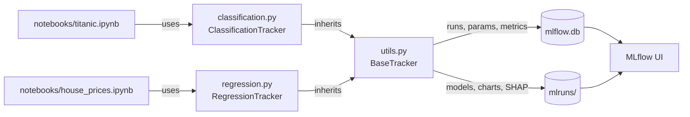
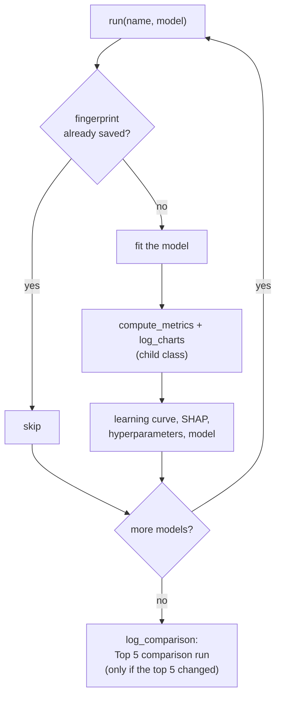

# MLflow Tracker

#### Video Demo: <PASTE_YOUR_YOUTUBE_URL_HERE>

#### Description:

**MLflow Tracker** trains scikit-learn models and saves *everything* about each one to
[MLflow](https://mlflow.org): the trained model, all its hyperparameters, its metrics, charts
(seaborn/matplotlib), a learning curve and SHAP explanations. It never saves the same model twice,
it compares the top 5 models automatically, and the whole project can be copied to another
computer without breaking MLflow.

It has two trackers built on the same base: one for **classification** and one for
**regression**. Two notebooks show them working on classic datasets:

- **Titanic** (classification): who survived the sinking?
- **California house prices** (regression): how much is a house worth?

---

## Architecture

```
mlflow-tracker/
├── utils.py                 # BaseTracker: everything the two trackers share
├── classification.py        # ClassificationTracker(BaseTracker): metrics + charts only
├── regression.py            # RegressionTracker(BaseTracker): metrics + charts only
├── notebooks/
│   ├── titanic.ipynb        # uses classification.py
│   └── house_prices.ipynb   # uses regression.py
├── data/
│   ├── titanic.csv
│   └── house_prices.csv
└── tests/test_trackers.py
```



`BaseTracker` (in `utils.py`) does all the MLflow work. Each child class only says **how a model is
graded**:

| | `ClassificationTracker` | `RegressionTracker` |
|---|---|---|
| Metrics | accuracy, precision, recall, F1, ROC AUC | MAE, RMSE, R² |
| Charts | confusion matrix, ROC curve | predicted vs. actual, residuals, residuals vs. predicted, actual vs. predicted distribution |
| Best model | highest F1 | lowest RMSE |
| SHAP explains | the probability of class 1 | the predicted value |
| Learning curve | the 5 metrics on train and test, with 20%...100% of the training rows | MAE, RMSE and R² on train and test, with 20%...100% of the training rows |

What `run_all(models)` does:



1. Computes a **fingerprint** (hash of the name, hyperparameters and data). If a run with that
   fingerprint exists, the model is skipped.
2. Trains the model, then the child class grades it: `compute_metrics()` and `log_charts()`.
3. Saves the model, every hyperparameter, the learning curve and two SHAP charts in one MLflow run.
4. After all models, saves a **Top 5 comparison** run with 6 charts: metrics bars, metrics heatmap,
   ranking, learning curves of the 5 models together, training time and SHAP importance per model.

---

## Quick start

Requires **Python 3.12**.

```bash
git clone https://github.com/MarcoBispo97/mlflow-tracker.git
cd mlflow-tracker

python -m venv .venv
source .venv/bin/activate          # Windows PowerShell: .\.venv\Scripts\Activate.ps1
pip install -r requirements.txt
```

The trained models are committed (`mlflow.db` and `mlruns/`), so you can open the MLflow UI right
away (see below). To train again, open `notebooks/titanic.ipynb` or `notebooks/house_prices.ipynb`
(in VS Code or Jupyter) and run all cells. Each notebook has the same 5 steps: data, models, train and track, compare, and use the
best model.

Results on the test set:

| Notebook | Best model | Score |
|---|---|---|
| Titanic | LightGBM | F1 = 0.745, ROC AUC = 0.840 |
| House prices | LightGBM | RMSE = 0.450 ($45,000), R² = 0.846 |

Run a notebook a second time and nothing is trained again: every model prints
`nothing changed -> skipped`. Change a hyperparameter and only that model gets a new run.

Then open the MLflow UI **from the project folder**:

```bash
mlflow ui --backend-store-uri sqlite:///mlflow.db
# open http://127.0.0.1:5000
```

---

## Using it with your own data

```python
import mlflow
from sklearn.model_selection import train_test_split
from regression import RegressionTracker   # or: from classification import ClassificationTracker

X_train, X_test, y_train, y_test = train_test_split(df[["a", "b", "c"]], df["price"], test_size=0.2)

mlflow.set_tracking_uri("sqlite:///mlflow.db")
tracker = RegressionTracker("my_experiment", X_train, X_test, y_train, y_test)
tracker.run_all({"Random Forest": RandomForestRegressor(), "Linear": LinearRegression()})

tracker.top_models()          # ranking, best first
tracker.comparison_charts()   # the 6 charts that compare the top 5
model, best_run = tracker.load_best_model()
```

The features must be numeric. For classification the target must be 0/1 and the model needs
`predict_proba` (for an SVM, use `SVC(probability=True)`).

A new kind of problem (e.g. multiclass) only needs a new child class with `METRICS`, `BEST`,
`compute_metrics()`, `log_charts()` and `predict_for_shap()`.

---

## Files

| File | What it does |
|---|---|
| `utils.py` | `BaseTracker`: fingerprint, training, saving the model and its hyperparameters, learning curve, SHAP, ranking (`top_models`), the top 5 comparison (`comparison_charts`, `log_comparison`) and `load_best_model`. Also `make_paths_relative()`, which keeps the project portable. |
| `classification.py` | `ClassificationTracker`: classification metrics, confusion matrix and ROC curve. |
| `regression.py` | `RegressionTracker`: regression metrics, predicted vs. actual and residuals charts. |
| `notebooks/titanic.ipynb` | Titanic: 7 classifiers (polynomial logistic regression, SVM, decision tree, LightGBM, XGBoost, random forest, k-nearest neighbors). |
| `notebooks/house_prices.ipynb` | California house prices: 7 regressors (linear regression, decision tree, random forest, LightGBM, XGBoost, gradient boosting, k-nearest neighbors). |
| `mlflow.db`, `mlruns/` | The MLflow database and artifacts of every trained model, committed so the results can be browsed without training. |
| `data/` | The two datasets, kept in the repository so the notebooks work offline. |
| `tests/test_trackers.py` | pytest tests for both trackers: metrics and charts, the fingerprint, skipping repeated models, the ranking direction, loading the best model and the relative paths. |
| `requirements.txt` / `requirements-dev.txt` | The dependencies and the development tools, with pinned versions. |
| `.github/workflows/ci.yml` | GitHub Actions: black and ruff, pytest, then runs both notebooks and checks that all 14 committed models are found and skipped (this also checks the relative paths on Linux). |

---

## Design decisions

**A base class and two small children.** Classification and regression trackers do the same MLflow
work and differ only in how a model is graded. The shared code lives once in `BaseTracker`, and
each child class fills in three methods (`compute_metrics`, `log_charts` and `predict_for_shap`) and three settings
(`METRICS`, `BEST`, `LOWER_IS_BETTER`). Reading one tracker explains the other.

**Never save the same model twice.** Running a notebook many times usually fills MLflow with
identical runs. Before training, the tracker computes a *fingerprint*: a SHA-256 hash of the model
name, its hyperparameters and the content of the train and test data. If a run with that
fingerprint already exists, the model is skipped. I hash the data content, not just its shape,
because a different row in the training set must produce a different model.

**Learning curves for any model.** Random forests, KNN or SVMs do not train in epochs, so they
have no loss-per-epoch curve. Instead, the tracker trains copies of the model on 20%, 40%, ... 100%
of the training rows and measures every metric on those rows (train) and on the test set. This
works for every model and shows overfitting: a big gap between the train and test lines. The
points are also saved as MLflow metrics with a `step`, so the MLflow UI can draw them too.

**Ranking in the right direction.** A higher F1 is better, but a lower RMSE is better. Each tracker
lists its error metrics in `LOWER_IS_BETTER`, so `top_models()` sorts ascending for them.

**Simple charts.** The charts are PNG images made with seaborn and matplotlib (plus sklearn's
`RocCurveDisplay` and SHAP's beeswarm plot), saved with `mlflow.log_figure`.

**Model-agnostic SHAP.** Each model type needs a different SHAP explainer. I used `shap.Explainer`
over a plain prediction function, so the same code explains a linear model, an SVM or XGBoost. The
trade-off is speed, so it explains 200 test rows against a background of 100 training rows.

**Preprocessing inside the pipeline.** Missing values are filled and features are scaled inside each
`Pipeline`, so these steps learn only from the training set (no data leakage) and are saved
together with the model.

**SQLite and portable paths.** Runs and metrics go to `mlflow.db` (SQLite) and artifacts to
`mlruns/`. MLflow stores absolute artifact paths such as `file:C:/Users/me/project/mlruns/...`,
which break when the folder is moved to another computer. `make_paths_relative()` rewrites them as
`mlruns/...` with a plain SQL `REPLACE`. This is why `mlflow ui` must be started from the project
folder.

**Committing the models.** `mlflow.db` and `mlruns/` are in the repository, so anyone can clone it
and browse every model, chart and metric in the MLflow UI without training. This works only because
the artifact paths are relative (see above). The trade-off is a bigger repository (about 25 MB).

**Loading a model.** `load_best_model()` uses `mlflow.sklearn.load_model("models:/<id>")`. Models
are saved with cloudpickle because MLflow's default format (skops) refuses tree models; only load
models you created yourself, because unpickling a file can run code.

---

## Development

```bash
pip install -r requirements.txt -r requirements-dev.txt
black .            # format
ruff check .       # lint (also checks the notebooks)
pytest             # tests
pre-commit install # run black and ruff before every git commit
```

---

## Limitations

- Classification is binary only (precision, recall and F1 are for the positive class).
- The evaluation is a single holdout split; cross-validation would give more stable metrics.

---

## AI usage

<!-- Edit this paragraph so it describes exactly how you used AI tools. -->
I designed and built this project in Jupyter notebooks while studying MLflow. I used Claude
(Anthropic's AI assistant) as a helper: to discuss design ideas, debug problems (such as the
absolute paths stored by MLflow), and to help me move the code from my notebooks into this
project, simplify it into a base class with two trackers, translate it from Portuguese to English,
and draft this README. I reviewed, ran and tested all of the code.

---

This was my final project for [CS50x](https://cs50.harvard.edu/x/).
